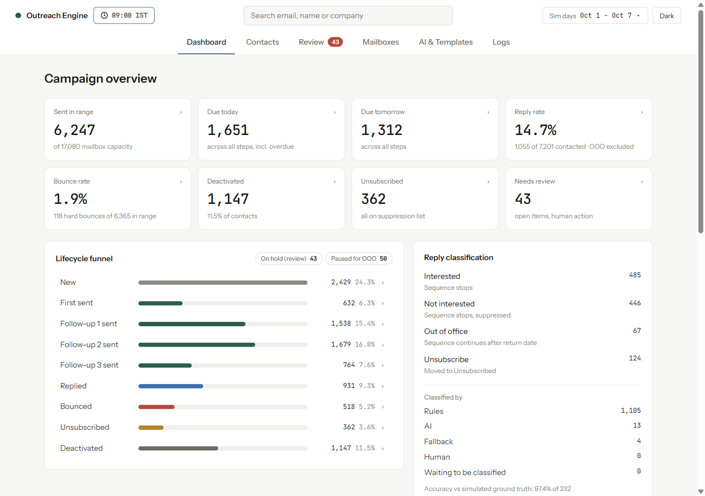

# coldemailer

A cold-email outreach engine that never loses track of a contact. It runs a first email and three follow-ups over 10,000+ prospects, and at any moment it can tell you who was emailed, who replied, who bounced or unsubscribed, what is due next, and who must never be contacted again. Sending is mocked: a simulated provider and simulated prospects live in the same SQLite file, so you can move the clock forward and watch weeks of a campaign play out in a couple of minutes. Free OpenRouter models write the email templates and label the replies the rules can't settle; the system works the same without an API key.



## Quick start

You need Python 3.12. Nothing else (no Node, no Docker, no database server).

**macOS / Linux**

```bash
python3.12 -m venv .venv && source .venv/bin/activate
pip install -r requirements.txt -e .
cp .env.example .env                       # optional: add an OpenRouter key
python -m coldemailer seed                  # 10,000 contacts with history (~3 s)
python -m coldemailer advance --days 14     # run two simulated weeks, one cycle per hour
python -m coldemailer report                # counts, due today/tomorrow, rates
python -m coldemailer serve                 # dashboard at http://localhost:8000
```

**Windows (PowerShell)**

```powershell
py -3.12 -m venv .venv; .venv\Scripts\Activate.ps1
pip install -r requirements.txt -e .
copy .env.example .env
python -m coldemailer seed
python -m coldemailer advance --days 14
python -m coldemailer report
python -m coldemailer serve
```

Run the tests with `pytest -q` (82 tests, about 7 seconds).

## Commands

| Command | What it does |
|---|---|
| `seed [--n 10000] [--seed 42]` | Wipes `data/coldemailer.db` and seeds contacts. Each one gets a random place in the sequence with matching history. Same seed, same data. The seed defaults to `COLDEMAILER_SEED` in `.env` (42 in `.env.example`). |
| `run` | Runs one cycle at the current simulated time. Run it twice and nothing is sent twice. |
| `advance --days N` / `--hours N` | Moves the clock forward, running one cycle per simulated hour (`--step` changes that). |
| `report [--from DAY --to DAY] [--json]` | Counts by status, sent in range, due today/tomorrow by step, reply and bounce rates, deactivated, suppression, deferrals. Days are IST. |
| `verify` | Checks 12 invariants over the whole database (listed below). Exits 2 if any fail. |
| `contact <email>` | One contact's facts and full timeline. |
| `review list` / `review resolve <id> <action>` | The human review queue (`retry_now`, `retry_later`, `mark_bounced`, `suppress`, `label:<label>`). |
| `mailbox resume <id>` | Resumes a mailbox that auto-paused. |
| `suppress <email>` | Adds a contact to the suppression list. |
| `templates warm` / `templates export` | Generates the per-segment templates with OpenRouter / writes them to `data/templates.seed.json`. |
| `serve [--port 8000]` | The API (`/docs` for the schema) and the dashboard. |

The dashboard has six tabs. **Dashboard** shows the KPIs, funnel, reply labels, sends per hour, deferrals, due-next, suppression, health and campaign settings. **Contacts** is every contact, filterable and paged. **Review** holds the human queue. **Mailboxes** shows warm-up ramps and auto-pauses. **AI & Templates** shows calls, 429s, fallbacks and the template cache; click any number to see the rows behind it, such as which emails used an AI-written template or which replies the LLM labelled. **Logs** has every event with filters and live tail; click a row to see the email that was sent (and whether AI wrote it), its delivery attempts, any reply with who classified it, or why a send was deferred. The clock button in the header advances time from the browser.

## How it works

```
                 ┌──────────── one SQLite file (WAL) ─────────────────────────────┐
  CLI ──┐        │ contacts ── sends ── send_attempts      events (append-only)   │
        ├─ engine│ replies   suppression   review_items    mailboxes/_daily       │
  API ──┘  cycle │ templates  llm_calls  cycles  jobs      clock  run_lock         │
   ▲             │                                                                 │
   │  React UI   │ sim_events  ← the outside world: the mock provider writes       │
   └─────────────│              acceptances, bounces and future replies here       │
                 └─────────────────────────────────────────────────────────────────┘
```

A single worker, `engine.run_cycle(from, to)`, covers one simulated interval. The order matters:

1. **Recover.** If a previous run crashed between "the provider accepted the email" and "we recorded it", ask the provider by idempotency key and finish the job. If the provider never saw it, release the claim.
2. **Ingest.** Apply replies, unsubscribe clicks and complaints that have arrived by now. A rules classifier runs right here, because whether a reply stops the sequence has to be decided before anything is sent.
3. **Deactivate.** Contacts whose last wait ran out without a reply.
4. **Send.** Scan due contacts through an index, follow-ups first, then first emails. Each one passes the gates (its own timezone's window, domain cap, mailbox warm-up limit, pacing), then goes through claim → provider → finalize.
5. **Auto-pause.** Any mailbox whose recent bounce or complaint rate crossed a threshold.
6. **Classify.** Label replies the rules couldn't settle, using the LLM when a key is set. This never blocks sending.

The CLI and the FastAPI server call the same modules. The dashboard is plain React 18 with `htm` from a CDN, so there's no build step and nothing to install beyond Python.

### Why this stack

- **SQLite instead of n8n, a CRM, or Postgres plus a queue.** The hard requirement is "never double-send, never lose a contact". That is easiest to guarantee when the guarantees are database constraints and transactions, all in one place you can read. SQLite also runs everywhere with zero setup, which matters when someone clones the repo onto a clean machine.
- **SQLite tables are B-trees, and the "traversal" is index design.** Due work is a range scan on a partial index `(next_action, next_action_at) WHERE next_action IS NOT NULL AND hold_reason IS NULL`. Contacts that stopped or are on hold aren't in that index at all, so the scan only touches live work. Paging uses keysets (`(next_action_at, id) > last`), not `OFFSET`.
- **FastAPI and no-build React.** A typed JSON API over the same functions the CLI uses, and a UI anyone can open without npm.
- **Python 3.12 standard library where possible.** `sqlite3`, `zoneinfo`, `hashlib`, `threading`. The dependencies are FastAPI, uvicorn, httpx, Faker and python-dotenv.

### Data model

| Table | Holds |
|---|---|
| `contacts` | Current state: `status`, `step` (steps sent, 0–4), `next_action` (`send_1..4` / `deactivate`), `next_action_at`, sticky `mailbox_id`, `hold_reason`, `ooo_until`, claim lease. |
| `sends` | One row per (contact, step), enforced by `UNIQUE(contact_id, step)`. Stores subject, body, headers (incl. List-Unsubscribe), template and state. |
| `send_attempts` | One row per attempt at a step (soft-bounce retries), each with its own `UNIQUE` idempotency key and result. |
| `events` | Append-only history: sent, replied, ooo, hard/soft bounce, deferred, needs_review, unsubscribed, complaint, deactivated, mailbox paused/resumed, ai_call, classified, human_action… |
| `replies` | Reply text, label, and who labelled it (rule / AI model / fallback / human). |
| `suppression` | Email → reason (hard bounce, unsubscribe link/reply, complaint, not interested, manual). Checked again at claim time. |
| `review_items` | The human queue: soft bounces, policy rejections, content blocks, unsure replies. |
| `mailboxes`, `mailbox_daily`, `domain_daily` | Warm-up schedule, pause state, per-day usage for limits. |
| `templates` | Segment (industry) × step × variant A/B, with the model that wrote it, plus static fallbacks. |
| `sim_events` | **The simulated outside world**: what the provider accepted, bounces, and future replies, clicks and complaints, each with a `deliver_at`. The engine reads only what a real inbox would show (SMTP code, reply text). The `true_label` column is read only by the report, to score the classifier. |
| `clock`, `run_lock`, `cycles`, `jobs`, `llm_calls`, `verify_runs` | The simulated clock, the run lock, and operational records. |

All timestamps are stored in UTC. Reports and the UI use IST, and "today" means the IST calendar day. Each prospect's sending window is computed in their own timezone with `zoneinfo`, so daylight-saving changes are handled.

## Lifecycle rules

```
new → first_sent → follow_up_1_sent → follow_up_2_sent → follow_up_3_sent → deactivated
         └─ at any step: replied | bounced | unsubscribed   (terminal)
```

- **Waits** are 3 / 5 / 7 days between steps, then 7 days after follow-up 3 before deactivation. A wait is counted in the prospect's local calendar days. The next send is scheduled at a deterministic random minute inside their 09:00–18:00 window, which spreads sends across the day.
- **A reply stops the sequence at once.** It's recorded, and the rules or the model label it interested, not interested or unsubscribe. "Not interested" also goes on the suppression list. An unsubscribe reply moves the contact to `unsubscribed`.
- **Out-of-office is the one deliberate exception to the brief's "a reply stops the sequence".** An auto-reply isn't a human answer. So the reply is recorded and the next step is pushed to the return date found in the text (or +3 days, capped at +14). The contact stays at its step, and the dashboard shows these as "Paused for OOO". This only applies when the text has no real answer in it. "On leave this week but interested" stops the sequence like any other reply.
- **Hard bounce** → `bounced` plus suppression. The address is never retried.
- **Unsubscribe link or complaint** → `unsubscribed` plus suppression. It's never contacted again; this is checked at claim time even if a row gets corrupted.
- **Soft bounce (human in the loop).**
  - Transient errors (421/450/452) retry the same step after 1 h, then 4 h, then 24 h. After the third failure the contact goes on hold for review.
  - Policy rejections (`5.7.x`) go to review immediately, because they point at reputation or content rather than the address.
  - A held contact is out of the due index, so nothing is sent to it until a person chooses Retry now, Retry later, Mark bounced or Suppress.
- **Content checks** run before every send: unrendered `{placeholders}`, spam words, too many links, length, missing unsubscribe link, an all-caps subject. A failure blocks the send and opens a review item.
- **Deactivated** is set when follow-up 3 went out and its wait passed with no reply.

## How double sends are prevented

Each layer stops a different failure:

1. **`UNIQUE(contact_id, step)` on `sends`.** The database itself refuses a second row for a step.
2. **A claim lease, re-checked in the claim transaction.** `UPDATE contacts SET claimed_by=…, claim_expires_at=… WHERE id=? AND step=n-1 AND next_action='send_n' AND status is active AND not held AND not already claimed RETURNING *` runs under `BEGIN IMMEDIATE`. If a reply, bounce or hold changed the contact since the scan, the update matches nothing and the send is skipped. Suppression is checked again in the same transaction.
3. **An idempotency key per attempt**, `sha256(contact:step:campaign:attempt)`. The mock provider dedupes on it the way a real ESP would, so retrying a "network call" that already succeeded changes nothing.
4. **Crash recovery.** A send left in `claimed` after its lease expires is resolved by asking the provider whether that key was accepted, never by sending again. The tests simulate a crash right after the provider accepts, then show recovery finishing the step with exactly one acceptance. If the contact replied, or an operator suppressed it, while that send was in flight, recovery records the email and stops there. It never brings a stopped contact back into the sequence.
5. **A run lock.** Only one process advances the clock or runs a cycle at a time. A second CLI run or a double click in the UI gets "another run is in progress" (HTTP 409).
6. **Ingest runs before the due scan** in every cycle, so a reply that arrives in the same hour a follow-up is due stops that follow-up.

`verify` checks the result from the other direction. Its 12 checks:

- Each contact's status matches what its event history implies.
- `step` equals the number of emails actually sent.
- No step was sent twice, and no attempt was accepted twice.
- Nothing was sent after the address was suppressed.
- Stopped contacts have no next action.
- Follow-ups respected the waits.
- Every engine send was inside the prospect's window.
- Mailboxes stayed within their warm-up limits, and recipient domains within their daily cap.
- Nothing was sent while a contact was on hold.
- Every reply or bounce that has arrived was processed.
- No active contact is missing a next action or stuck with a stale claim.

## The simulation

- **Clock.** The `clock` row is the only "now". It only moves forward (moving it back raises an error), and `advance` runs one cycle per simulated hour. Nothing in the business logic reads wall-clock time.
- **Mock provider.** It accepts or bounces each attempt, at 1.5% hard bounces and 1.5% soft bounces by default (a third of the soft ones are policy rejections). For accepted emails it may schedule one future reaction: a reply (6/5/4/3% by step; 30% interested, 30% not interested, 25% out of office, 15% unsubscribe), an unsubscribe click (0.5%) or a complaint (0.1%), arriving 2 hours to 4 days later. Every roll uses a RNG keyed on the attempt's idempotency key, so results don't depend on run order. Reply text comes from a phrase corpus; there's no LLM in the simulation. About 15% of interested and not-interested replies are deliberately ambiguous, so the AI path has real work to do.
- **Two designed problems** make the safety features visible:
  - Three "dead" company domains bounce 40% of the time.
  - One mailbox (`sales20@mail-e.test`) has a poor sending reputation, with an extra 10% policy rejections. It auto-pauses on day 1.
- **Seed data.** 10,000 contacts from Faker with a fixed seed: 5 industries, 8 roles, 7 timezones, about 2,500 company domains. The mix of statuses is new 40%, first_sent 15%, follow-up 1/2/3 10/8/7%, replied 8%, bounced 4%, unsubscribed 3%, deactivated 5%. History is built backwards from the clock using the same scheduling function the engine uses, so a contact on follow-up 2 has a first email and follow-up 1 exactly where the engine would have put them. Seeded history counts as imported data (`source='import'`). It respects the waits and prospect windows but not warm-up limits, and `verify` holds it to the lifecycle rules only.

## Where AI is used, and the rate limits

**Models** (all `:free` on OpenRouter, set in `.env`, tried in order): `recursive/flint-v1.0:free` → `nvidia/nemotron-3.5-super-vl:free` → `poolside/laguna-s-2.1:free`. Free model IDs churn: the chain the 10k run used (Gemma 4 → MiniMax) has since gone 429/404, so check `https://openrouter.ai/api/v1/models` if a call returns 404. The 40 committed templates were written by MiniMax.

- **Writing emails: templates per segment, not per contact.**
  - Calling a model once per email would mean 10,000+ calls, against free limits of about 20 a minute. Instead, `templates warm` writes one template per industry × step × variant: 5 × 4 × 2 = 40 calls, cached in the `templates` table.
  - The engine fills in name, company, role and topic locally.
  - Each template is validated before it's stored: only allowed merge fields, an unsubscribe line, and a pass through the content checks. Anything invalid is skipped, and the static template stays in its place.
  - The 40 generated templates are committed in `data/templates.seed.json`, so a grader without a key still sees AI-written emails.
  - Sending never waits on a model.
- **Labelling replies: rules first, the model for the rest, in batches.**
  - Rules catch out-of-office, unsubscribe and clear yes/no replies while the reply is being ingested.
  - What's left is sent 10 replies per call, as a JSON array.
  - A reply the model can't settle twice goes to the human review queue.
  - With no key, a keyword fallback labels it.
  - Either way the contact has already stopped, so a model outage can't cause or block a send.
- **Rate-limit handling.**
  - An in-process token bucket at 15 requests a minute.
  - Inside a cycle nothing ever sleeps. A 429 puts that model on cool-down for its `Retry-After` (at least 60 s), and the next model in the chain is tried at once.
  - Offline batch jobs (`templates warm`) are patient instead: up to 3 tries per model with `Retry-After` or exponential back-off with jitter, and one wait for the earliest cool-down before giving up.
  - If the whole chain fails, write an `ai_fallback` event and use the static template or keyword label.
  - Every HTTP attempt is logged in `llm_calls` and as an `ai_call` event; the AI & Templates tab shows calls, 429s, retries and fallbacks per model.
  - In my runs Gemma 4 returned 429 almost every time, and the chain moved on to MiniMax automatically.
- **The daily cap is the real limit.** My key is on OpenRouter's free tier, which allows **50 free-model requests a day across all `:free` models** (1,000 a day after adding $10 of credit), resetting at 00:00 UTC. Per-minute limits are handled by the token bucket and cool-downs above; the daily cap can't be retried away. In the 10k run below, **53 of the 94 AI calls got a 429** because the key ran out of its 50 for the day partway through, so every model in the chain answered 429 and the keyword fallback labelled the rest. Nothing waited on it and no send was affected. With a credited key, or the run started on a fresh day's budget, the LLM handles more of the replies the rules leave over.
- **What I'd do in production, against what this does now with one free key:**
  1. **Buy more capacity.** A paid tier or reserved throughput (OpenRouter credits alone lift the cap to 1,000 a day). Now: one free-tier key, 50 a day.
  2. **Route across models and providers.** A gateway (LiteLLM, Portkey) that fails over between providers, not just models. Now: a three-model `:free` chain with per-model cool-downs.
  3. **Send fewer requests.** Already the core of the design: 40 cached templates instead of one call per email, rules before the LLM, 10 replies per call. Next: a semantic cache for repeated reply wording.
  4. **Absorb the bursts.** A queue with workers draining at the allowed rate, user-facing work ahead of batch jobs. Now: a token bucket, no sleeping inside a cycle, and a fallback so no send ever waits on a model.

## Warm-up and spam management (bonus)

- **20 mailboxes with warm-up.** The daily limit starts at 20, rises by 10 a day and caps at 200, with start dates staggered. The Mailboxes tab shows each mailbox's 28-day ramp against what it actually sent.
- **Sends spread out, not in bursts.** There are three layers to this:
  - each follow-up is scheduled at a random minute inside the prospect's window;
  - each mailbox keeps a minimum gap between sends (a 9-hour day divided by today's limit);
  - follow-ups keep the same mailbox so the email thread stays consistent, while each first email goes to whichever active mailbox can send soonest (most room left breaks ties), so every mailbox's paced slots get used rather than queueing behind the biggest one. On a 3-day 10k run this lifted day-one capacity use from 73% to 92% and cut pacing deferrals by three quarters.
  - The "Sends per hour" chart shows the result.
- **Auto-pause** triggers when a mailbox's bounce rate (hard bounces plus policy rejections) is over 5% across its last 200 attempts, or its complaint rate is over 0.3% across its last 2,000. Resuming is a human action, and after a resume only new attempts count, so the old bounces don't pause it again straight away.
- **Suppression list**, an **unsubscribe link** in every body, and **`List-Unsubscribe` + `List-Unsubscribe-Post: One-Click`** headers on every send.
- **Content checks** before every send, **sending windows** in the prospect's timezone, and a **per-recipient-domain cap** of 50 a day.

## Results

### 10,000 contacts, 60 simulated days

Run on my machine (Windows 11, Intel 12-thread laptop CPU, Python 3.12.7, SQLite 3.45.3) with the OpenRouter key on. Full report: [`docs/results/run-10k.md`](docs/results/run-10k.md).

| Phase | Wall time |
|---|---|
| Seed 10,000 contacts with history | 2.8 s |
| Advance 60 days (1,440 hourly cycles) | 3 min 42 s (3.7 s per simulated day, including real free-model calls) |
| `verify` (12 checks) | 1.9 s, **all pass** |

| Final status | Contacts | Share |
|---|---:|---:|
| New | 28 | 0.3% |
| First sent | 30 | 0.3% |
| Follow-up 1 sent | 34 | 0.3% |
| Follow-up 2 sent | 36 | 0.4% |
| Follow-up 3 sent | 0 | 0.0% |
| Replied | 1,364 | 13.6% |
| Bounced | 778 | 7.8% |
| Unsubscribed | 534 | 5.3% |
| Deactivated | 7,196 | 72.0% |
| **Total** | **10,000** | |

- **The campaign finished.** Every contact reached a final status except the 128 still on hold, which are waiting for a human in the Review tab. All 128 are policy rejections (`5.7.x`); transient soft bounces all cleared on retry.
- 20,855 emails were sent during the run, on top of 13,387 imported history sends. Sending was essentially done by Oct 28; before first emails were spread across every mailbox with a free slot, the tail ran to about Nov 9.
- Reply rate was 14.3% (1,364 replied of 9,551 contacted; out-of-office and unsubscribe replies aren't counted as replies) and bounce rate 1.8%. 251 out-of-office replies pushed a sequence back instead of stopping it.
- 7 of 20 mailboxes ended paused. One is the designed poor-reputation mailbox and one tripped the complaint threshold. The other five crossed 5% bounces on ordinary bounce spikes (four of them at 5.5%): mailboxes that now carry real volume reach auto-pause's 100-attempt sample. All can be resumed from the Mailboxes tab.
- Reply labels: 1,738 by rules, 35 by the LLM and 66 by the keyword fallback, with **98.7% agreement** with the simulator's ground truth (949 checked).
- There were 94 LLM calls: 41 succeeded and 53 got a 429. Partway through, the key hit OpenRouter's free-tier cap of 50 free-model requests a day (1,000 with $10 of credit), so every model in the chain answered 429 and the keyword fallback took over. No send waited on it, which is the point of the design.

### 100,000 contacts, 14 simulated days (scale check, no AI)

This is a separate scale check: `python scripts/full_run.py --n 100000 --days 14 --no-ai`. It was measured before the final review fixes and before first emails were spread across every mailbox with a free slot, so its reply rate uses the earlier definition (any non-OOO reply) and its send count is a lower bound. Full report: [`docs/results/run-100k.md`](docs/results/run-100k.md).

| Phase | Wall time |
|---|---|
| Seed 100,000 contacts with history (133,537 history sends) | 33 s |
| Advance 14 days (336 hourly cycles) | 8 min 7 s (~35 s per simulated day) |
| `verify` (12 checks) | 4.0 s, **all pass** |

- 29,504 emails were sent. Reply rate was 16.9%, bounce rate 2.0%, and classifier agreement with ground truth 98.4%.
- All 40,000 `new` contacts are still unsent after 14 days, and that's by design. With 20 warming mailboxes (at most 4,000 sends a day), the 60,000 contacts already in the sequence use all the capacity, and follow-ups always go before first emails. The fix is more mailboxes, not more code: `mailbox_count` in `config.py`.
- The cost per cycle grows with the number of due-but-deferred contacts, because each one is re-checked every hour. That's fine at this size. At millions, I'd defer by moving `next_action_at` to the next moment a mailbox has room, rather than re-checking every hour.

## Tests

`pytest -q` runs 82 tests in about 7 seconds:

- **Lifecycle:** a full sequence through to deactivation, a reply stopping it, out-of-office pushing it, hard bounces, unsubscribes and complaints, soft-bounce retries through to review, and policy rejections.
- **Exactly-once:** running the same clock twice, running the same interval twice, a crash after the provider accepted, a crash before it, a reply landing in the same cycle a follow-up is due, the run lock, the clock refusing to go backwards.
- **Sending policies:** timezone windows including a daylight-saving change, the warm-up limit and its ramp, pacing, the domain cap, every mailbox paused, auto-pause and resume, follow-ups before first emails, content blocks.
- **Seed and verify:** the seed is deterministic, matches the status mix and has consistent history; `verify` passes after seeding and advancing and catches deliberate drift.
- **AI:** 429 retries, the model chain and cool-downs, total failure, the token bucket, the rules classifier against the corpus, return-date parsing, batched LLM labelling and review, template validation. All of it uses mocked HTTP and a fake clock.
- **API:** every endpoint, the job lock (409), and an empty database.
- **Review regressions:** crash recovery not reviving a contact who replied or was suppressed, deferral dedupe when reasons alternate, a resumed mailbox judged only on new sends, no sleeping on a 429 inside a cycle, out-of-office with a real answer, and the reply KPI matching its drawer.

## Trade-offs, known limitations, what I'd build next

- **Single writer.** One process advances the campaign at a time; SQLite with WAL handles the reads. That's comfortable at 10k–100k contacts. For millions, or several workers, I'd move to Postgres with `SELECT … FOR UPDATE SKIP LOCKED` claims and keep the same schema and invariants.
- **The run lock uses wall-clock time with a TTL**, because it protects real processes. If a process is killed, a new run can start once the lease expires (10 minutes).
- **Throughput is limited by warm-up on purpose.** 20 new mailboxes can't send 10,000 first emails in a day, and the "Mailbox at capacity" deferrals show that. Pacing spreads each mailbox over a 9-hour day; a list with prospects in only one timezone won't use a mailbox's whole daily limit.
- **Contact paging uses `LIMIT/OFFSET`.** Page numbers need that, and it's fast enough at this size; the logs use keyset paging.
- **Classification stays forward-only.** A reply the rules couldn't settle stops the sequence even if the model later says it was out-of-office. Stopping is the safe side.
- **Deliverability is simulated.** There are no real MX, SPF/DKIM or IMAP checks.
- **Next:**
  - per-contact AI openers for high-value segments only, on a budget;
  - A/B results by template variant (the data is already in `sends`);
  - Docker Compose;
  - multi-campaign support (`campaign_id` is already threaded through the keys);
  - a real ESP adapter behind the same `send(idempotency_key, …)` interface.

## How this was built

The thinking is committed alongside the code:

- `docs/superpowers/specs/2026-10-21-coldemailer-design.md` is the design, including the decisions and why they were made.
- `docs/superpowers/plans/2026-10-21-coldemailer.md` is the task-by-task build plan.
- `web/mockup/` holds the dashboard mockups the UI was built from.
